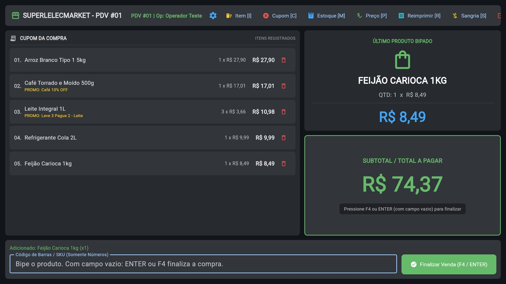
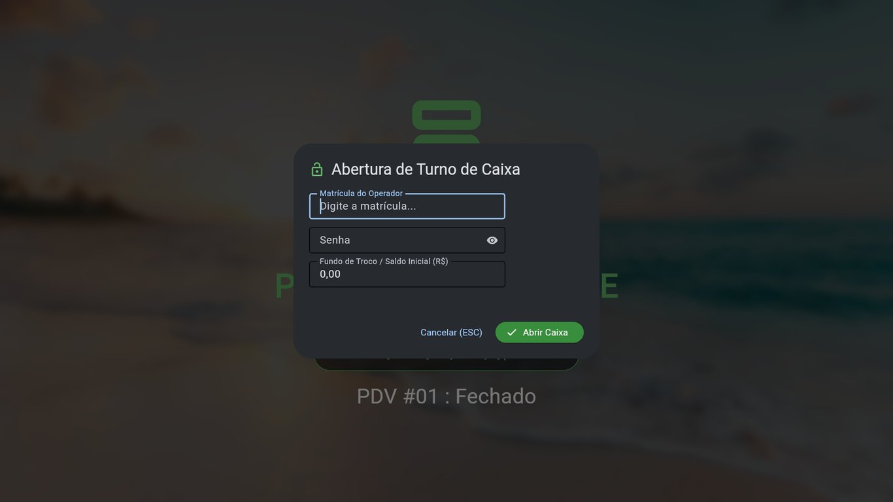
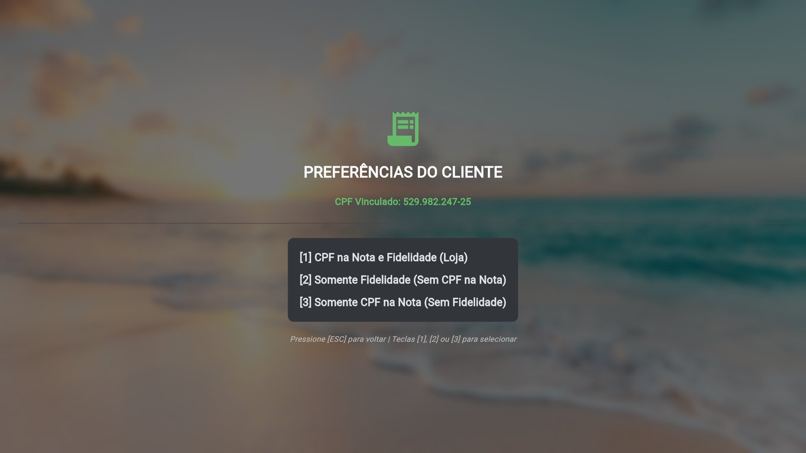
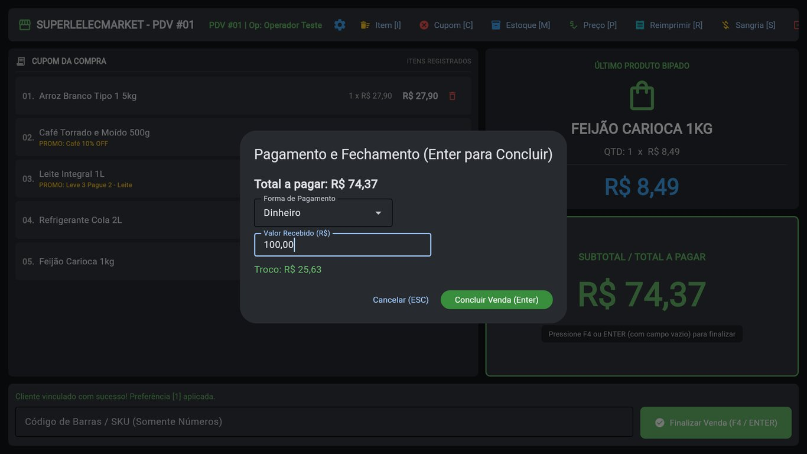
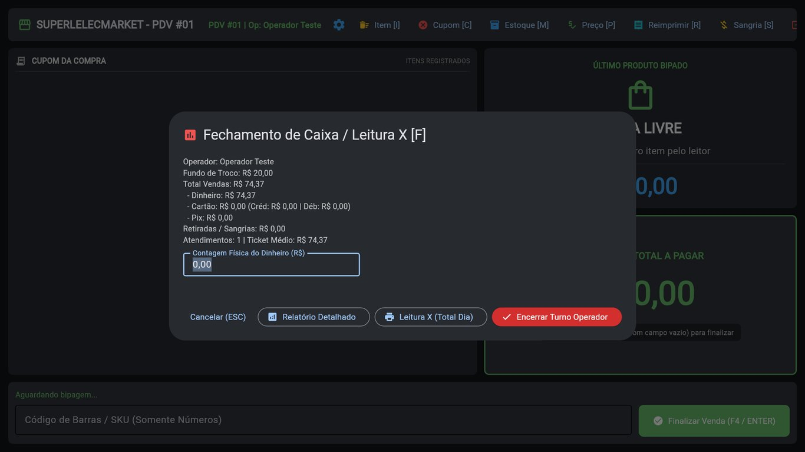
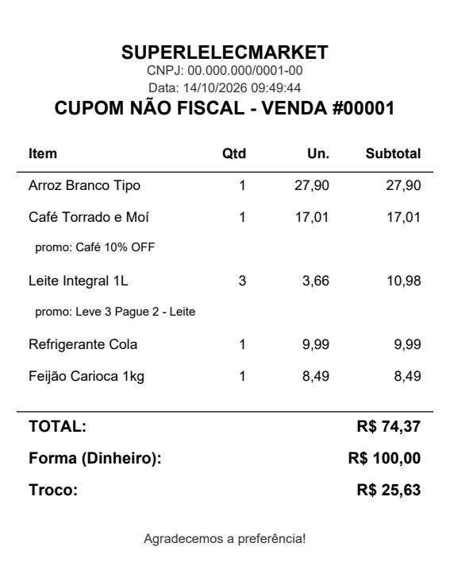

# PDV SuperLelecMarket


Sistema de **ponto de venda (PDV) para supermercado** feito em Python, com interface desktop em Flet,
banco central PostgreSQL e **modo offline**: se o servidor cair, o caixa continua vendendo e sincroniza tudo
quando a conexão volta, sem duplicar vendas.



<details>
<summary><b>Mais telas</b> (dados fictícios)</summary>

| Descanso | Abertura do turno |
|---|---|
|  |  |
| **Identificação do cliente** | **Pagamento com troco** |
|  |  |
| **Fechamento / Leitura X** | **Cupom não fiscal (PDF)** |
|  |  |

</details>

## Funcionalidades

- **Venda rápida por teclado**: leitor de código de barras, atalhos de tecla e pagamento em Dinheiro (com troco), PIX, crédito ou débito
- **Identificação do cliente por CPF** (validado), com acúmulo de pontos
- **Promoções** aplicadas automaticamente no carrinho
- **Modo offline**: cache local de produtos e promoções, e fila de vendas que sincroniza em segundo plano
- **Recuperação do carrinho**: se o PDV fechar no meio da venda, ela volta ao reabrir
- **Turno de caixa**: abertura, sangria, Leitura X e fechamento com relatório
- **Comprovantes em PDF** (bobina 80 mm): cupom não fiscal, sangria e fechamento
- **Controle de acesso**: operador e gerente, senha de supervisor para cancelamentos acima de um limite
- **Consultas**: verificação de preço e de estoque

### Atalhos na tela de venda

| Tecla | Ação | Tecla | Ação |
|---|---|---|---|
| `F4` | Pagamento | `P` | Verificar preço |
| `I` | Cancelar item | `M` | Consultar estoque |
| `C` | Cancelar cupom | `S` | Sangria |
| `R` | Reimprimir último cupom | `F` | Fechamento de caixa |
| `Esc` | Fechar janela / voltar | | |

## Decisões técnicas

- **Vendas idempotentes:** toda venda tem um UUID. Reenviar a mesma venda da fila offline não a duplica (`ON CONFLICT`).
- **Dinheiro sempre em `Decimal`:** com `float` o erro de arredondamento vira diferença de caixa.
- **Offline-first:** a venda offline recebe a referência `OFF-00007` no cupom e o estoque e os pontos entram na sincronização.
- **Estoque negativo permitido, mas auditado:** a venda não trava no balcão e a diferença fica registrada em `divergencias_estoque`.
- **Segurança:** senhas com bcrypt (senhas antigas em texto puro são migradas), bloqueio de 5 min após 5 senhas erradas e nenhum segredo no código (tudo vem do `.env`).
- **Resiliência:** pool de conexões thread-safe com reconexão automática e timeout curto, para o bip não travar quando o servidor cai.
- **Migrações idempotentes:** o schema é criado e atualizado a cada inicialização.

## Arquitetura

```
             ┌────────────── pdv/ui (Flet) ──────────────┐
             │  telas · modais · atalhos de teclado      │
             └─────────────────────┬─────────────────────┘
                                   │
             ┌──────────── pdv/services ─────────────────┐
             │  promoções · sincronização em 2º plano    │
             └─────────────────────┬─────────────────────┘
                                   │
             ┌───────────────── pdv/db ──────────────────┐
             │ vendas · caixa · produtos · usuários ...  │
             └──────────┬─────────────────────┬──────────┘
                        │                     │
                 PostgreSQL (central)  ⇄  SQLite (cache + fila offline)
```

```
├── main.py               # ponto de entrada
├── pdv/
│   ├── config.py         # configuração via variáveis de ambiente / .env
│   ├── money.py          # helpers de Decimal
│   ├── criar_usuario.py  # CLI para criar usuários
│   ├── demo.py           # modo demonstração com dados fictícios
│   ├── db/               # acesso a dados, pool, migrações, SQLite local
│   ├── services/         # promoções e sincronização offline
│   ├── relatorios/       # PDFs (cupom, sangria, fechamento)
│   └── ui/               # interface Flet
└── tests/                # pytest (lógica, SQLite e PostgreSQL)
```

## Como rodar

**Pré-requisitos:** Python 3.10+ e um PostgreSQL acessível.

```bash
pip install -r requirements.txt
copy .env.example .env    # Linux/macOS: cp .env.example .env
python main.py
```

Preencha o `.env` com os dados do banco. `DB_PASS` é obrigatório: sem ele o programa não abre.
O banco pode estar vazio: as migrações criam todas as tabelas na primeira execução.
Use `python main.py --web` para abrir a interface no navegador.

### Modo demonstração

Para testar sem dados próprios:

```bash
python -m pdv.demo          # adicione --web para abrir no navegador
```

O comando usa as credenciais do `.env`, mas cria um banco **separado** (`pdv_demo`) com 10 produtos,
2 promoções e um cliente fictícios. Os arquivos locais ficam na pasta `demo/`, então o banco de produção
e a fila offline real não são tocados. Entre com `1001` / `1234` (operador). `--reset` recria tudo do zero.

### Usuários

- **Produção:** `python -m pdv.criar_usuario` cria um usuário com senha em bcrypt.
- **Desenvolvimento:** com `PDV_DEV=1` no `.env`, o sistema cria `1001/1234` (operador), `2001/4321` (gerente) e `9999/admin`. Ele nunca sobrescreve um usuário existente.

## Testes

```bash
pip install -r requirements-dev.txt
pytest          # lógica + SQLite
ruff check .    # lint
```

Para incluir os testes de integração com PostgreSQL, defina `PDV_TEST_PG=1` e as variáveis `DB_*`
apontando para um **banco descartável** (o schema `public` é recriado). No GitHub Actions isso roda
automaticamente com um container PostgreSQL.

## Autor

**Lucas Vieira Dias**
[LinkedIn](https://www.linkedin.com/in/lucas-vieira-dias-9042b519a/) · [GitHub](https://github.com/LelecHub)

## Licença

Distribuído sob a licença MIT. Veja [LICENSE](LICENSE).
